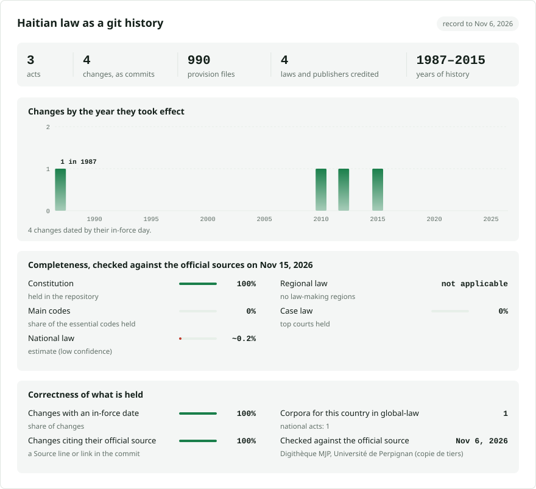

# Haiti: law history in git

[Français](README.md) · **English**

<picture>
<source media="(prefers-color-scheme: dark)" srcset="data/effort-dark.svg">

</picture>

The law of Haiti as a git history: one file per article, one commit per version on the day it took effect, and the act that made each change as the commit's author. `git blame` names the act behind every article; `git log` lists every change to an article; picking a date gives the text in force that day.

Part of [lexifina/global-law](https://github.com/lexifina/global-law), one git history for every country's law: this is Haiti's national law, which global-law reads at `haiti/national/acts/`.

**What is in it now:** the Constitution of 29 March 1987, as ratified and as amended in 2011 (text published 19 June 2012); 5 codes in `codes/` (Penal Code, Code of Criminal Procedure, Labour Code, …); and laws, decrees and orders from 1926 to 2025 (27 laws, 5 decree-laws, 33 decrees, 24 orders (arrêtés)), one folder per text, one file per article. See [STRUCTURE.md](STRUCTURE.md) and `corpus.json`.

Each act has its own folder, with one file per article (`codes/code-du-travail/art-001.md` is Article 1 of the Code du travail; the Constitution's Article 1.1 is `constitution/art-001-01.md` and its preamble `constitution/preambule.md`); the pension decree is one file, `decrets/2015/10-09-pension-civile/texte-integral.md`. Each folder's `README.md` lists its articles.

The text is in French, as the sources print it. Haitian Creole texts and English translations are not part of this record.

## Questions as git commands

| Question | Command |
| --- | --- |
| Every change to Article 1 of the Code du travail | `git log -p --word-diff -- codes/code-du-travail/art-001.md` |
| Which act wrote each line of Article 1? | `git blame codes/code-du-travail/art-001.md` |
| Every version of the Code du travail, with the day each took effect | `git log --format="%h %(trailers:key=In-force,valueonly,separator=) %an" -- codes/code-du-travail` |
| Article 1 as in force on 1 January 2015 | `python tools/on.py 2015-01-01 codes/code-du-travail art-001` |

**Outside git**, we also host this record publicly, for free:

- **[Ask Claude about Haitian law](https://global-law.lexifina.com/v1/try_claude?country=haiti)**: opens Claude with a first question ready.
- **[Ask ChatGPT](https://global-law.lexifina.com/v1/try_chatgpt?country=haiti)**: the same question in ChatGPT.
- **[Search Haitian law on our site](https://lexifina.com/law?country=haiti&q=cong%C3%A9+annuel)**: a search for "congé annuel", with each provision's text and its versions, no account needed.
- **[Developer REST API](https://global-law.lexifina.com/v1/search_law?query=cong%C3%A9+annuel&jurisdiction=haiti)**: the same search as JSON, with no key. See the [documentation here](https://lexifina.com/api/global-law).

Both assistants read the record through the free Global law connector (MCP, `https://global-law.lexifina.com/mcp`); the first time, the chat gives you the link that adds it. Ask in French or in English.

**Host it yourself easily.** All it takes is git and Python, and the tools run on your machine:

```sh
git clone --depth 1 https://github.com/lexifina/global-law && cd global-law
python3 tools/countries.py add haiti/national/acts
python3 tools/law.py show 2026-01-01 haiti/national/acts/codes/code-du-travail/art-001.md
```

Opened in Claude Code, Cursor, VS Code or Codex, the clone also starts a local MCP server with the same tools ([MCP.md](https://github.com/lexifina/global-law/blob/main/MCP.md)).

## Dates

Each commit is dated at noon, America/Port-au-Prince, on the day the version took effect, and carries it in its `In-force:` trailer:

- the Constitution: 29 March 1987, the day it was ratified by referendum (Article 298 puts it in force on publication in Le Moniteur; the ratification day is used), then 19 June 2012, the Moniteur extraordinaire that published the corrected text of the 2011 amendment; the first publication of 13 May 2011 differed from what the Assembly approved and is not used;
- the Code du travail: 31 August 2010, the date of the copy used, not a day the law took effect; the copy reflects the Decree of 24 February 1984 and the Loi du 5 juin 2003;
- the pension decree: 26 October 2015, its publication day in Le Moniteur no 205, from which its Article 41 applies it.

The 1987 text is credited to the Constitution itself, and the 2012 version to the 2011 constitutional amendment, and that commit changes only the articles the source marks as amended. The Code du travail and the pension decree, each held in one text, are the "oldest version available", credited to the source that published the text.

## How it is checked

- `tools/check_repo.py` reads every version back from git on the day it took effect and on the day before, and compares it with the corpus: 0 mismatches. A second build from the same corpus gave the same hashes. Both are in `REPRODUCE.md`.
- Each version names its source page and the sha256 of the bytes it was read from (`data/versions.json`).
- No merge commits, no commit dated after the build, and every commit's trailers parse.
- [vulnerabilities/](vulnerabilities/README.en.md): possible drafting mistakes in this law, found by global-law's detectors and checked by hand. Not run yet.

## What it does not show

- **The official gazette.** Le Moniteur has no comprehensive online archive; the Constitution and the Code du travail are unofficial third-party copies, so check them against Le Moniteur for anything that matters.
- **All texts.** Most official PDFs (MEF, Budget) and FAOLEX copies are scans with no text layer or an unreadable one: they are left out (we do no OCR). Left out for that reason: the new Penal Code and Code of Criminal Procedure of 2020 (Moniteur spécial no 10, 24 June 2020; entry into force postponed several times) and the Civil Code of 1825 (the text layer of the scanned 1826 edition is too damaged). Each text is recorded as published by its source, in one version; later amendments are not yet replayed. No Cour de cassation judgments are published online.
- **Later changes**: to the Constitution other than the 2011 amendment, and to the Code du travail or the pension decree after the texts used.
- **Headings** of the Constitution and the Code du travail: titles, chapters and sections are left out; each article is a file.
- **Seven articles of the Code du travail** (426, 483, 505 and 507 to 510): the copy prints only a summary, and those files say the source does not give the text.

## Sources

| Source | Kind | Past versions | Notes |
| --- | --- | --- | --- |
| [Digithèque MJP](https://mjp.univ-perp.fr/constit/ht1987.htm), Université de Perpignan | Third-party copy of the Constitution | yes, the 1987 text and the [amended text](https://mjp.univ-perp.fr/constit/ht2011.htm) | Unofficial; the amended page marks repealed and new words |
| [CEPAL, Gender Equality Observatory](https://oig.cepal.org/sites/default/files/2003_codtravail_hti.pdf) | Third-party copy of the Code du travail | no, one copy (2010) | Unofficial |
| [Le Moniteur no 205](https://www.mef.gouv.ht/storage/app/uploads/public/622/0fc/989/6220fc98951f1364533445.pdf) (Ministère de l'Économie et des Finances) | Official gazette | no, as published | The 2015 pension decree |
| [MEF](https://www.mef.gouv.ht/cadre-reglementaire/lois) and [Direction générale du Budget](https://budget.gouv.ht/cadre-reglementaire/lois), regulatory framework pages | Le Moniteur issues published by the State | no, as published | Laws, decrees and orders with a readable text layer |
| [FAOLEX](https://faolex.fao.org/) (FAO) | Third-party copies | no | `Source-status: secondary copy (FAOLEX …)` |
| haitijustice.com (CRIJ), [Wayback Machine](https://web.archive.org/web/2016/http://haitijustice.com/) copies | Third-party copies; site closed | no, texts consolidated by the source | Penal Code, Code of Criminal Procedure, laws; `Source-status: secondary copy (haitijustice.com …)` |

## Licence

See `LICENSE`. Haiti's Decree of 12 October 2005 on copyright (Article 5) excludes official legislative texts from protection; the third-party hosts are credited as the source of the bytes. The arrangement, tables, commit messages and tools are dedicated to the public domain (CC0 1.0).

No AI model wrote, translated or corrected legal text; the scripts were written by an AI model, and a model identified document boundaries and source dates (see `REPRODUCE.md`).

## Visualisations

- [visualisations/](visualisations/README.en.md): charts drawn from this repository. Not drawn yet.

## More

From [lexifina/global-law](https://github.com/lexifina/global-law):

- [FEATURES.md](https://github.com/lexifina/global-law/blob/main/FEATURES.md): every feature, and what every corpus must support (`git blame`, `law.py`, the MCP tools)
- [FAQ.md](https://github.com/lexifina/global-law/blob/main/FAQ.md): questions and answers · [CONTRIBUTING.md](https://github.com/lexifina/global-law/blob/main/CONTRIBUTING.md): proposing changes · [MCP.md](https://github.com/lexifina/global-law/blob/main/MCP.md): the MCP server · [REPRODUCE.md](https://github.com/lexifina/global-law/blob/main/REPRODUCE.md): how it was built · [CHANGELOG.md](https://github.com/lexifina/global-law/blob/main/CHANGELOG.md)
- [FRESHNESS.md](https://github.com/lexifina/global-law/blob/main/FRESHNESS.md): how current each corpus is · [Monitoring](https://github.com/lexifina/global-law/tree/main/monitoring): whether updates are running · [WATCHING.md](https://github.com/lexifina/global-law/blob/main/WATCHING.md): how each official source is watched for changes
- [performance/](https://github.com/lexifina/global-law/tree/main/performance): how fast the tools are, measured
- [visualisations/](https://github.com/lexifina/global-law/tree/main/visualisations): charts and bridges across the world's law
- [Vulnerabilities](https://github.com/lexifina/global-law/tree/main/vulnerabilities): mistakes in legislation as published
