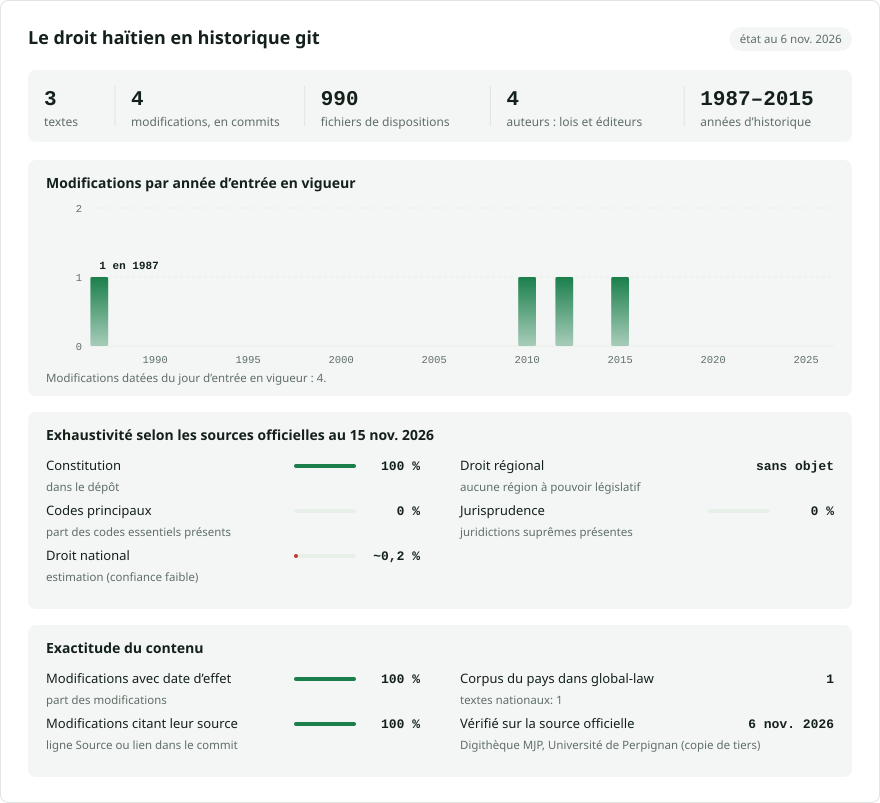

# Haïti : l’histoire du droit dans git

**Français** · [English](README.en.md)

<picture>
<source media="(prefers-color-scheme: dark)" srcset="data/fr/effort-dark.svg">

</picture>

Le droit d’Haïti sous la forme d’un historique git : un fichier par article, un commit par version à la date de son entrée en vigueur, et l’acte auteur de chaque modification comme auteur du commit. `git blame` indique l’acte à l’origine de chaque article ; `git log` liste toutes les modifications d’un article ; le choix d’une date donne le texte en vigueur ce jour-là.

Fait partie de [lexifina/global-law](https://github.com/lexifina/global-law), un historique git unique pour le droit de tous les pays : il s’agit ici du droit national d’Haïti, que global-law lit sous `haiti/national/acts/`.

**Contenu actuel :** la Constitution du 29 mars 1987, telle que ratifiée et telle qu’amendée en 2011 (texte publié le 19 juin 2012) ; 5 codes dans `codes/` (Code pénal, Code d’instruction criminelle, Code du travail, …) ; et des lois, décrets et arrêtés de 1926 à 2025 (27 lois, 5 décrets-lois, 33 décrets, 24 arrêtés), un dossier par texte, un fichier par article. Voir [STRUCTURE.md](STRUCTURE.md) et `corpus.json`.

Chaque acte a son propre dossier, avec un fichier par article (`codes/code-du-travail/art-001.md` est l’article 1er du Code du travail ; l’article 1.1 de la Constitution est `constitution/art-001-01.md` et son préambule `constitution/preambule.md`) ; le décret sur les pensions tient en un seul fichier, `decrets/2015/10-09-pension-civile/texte-integral.md`. Le `README.md` de chaque dossier liste ses articles.

Le texte est en français, tel que les sources l’impriment. Les textes en créole haïtien et les traductions anglaises ne font pas partie de ce corpus.

## Questions sous forme de commandes git

| Question | Commande |
| --- | --- |
| Toutes les modifications de l’article 1er du Code du travail | `git log -p --word-diff -- codes/code-du-travail/art-001.md` |
| Quel acte a rédigé chaque ligne de l’article 1er ? | `git blame codes/code-du-travail/art-001.md` |
| Toutes les versions du Code du travail, avec la date d’entrée en vigueur de chacune | `git log --format="%h %(trailers:key=In-force,valueonly,separator=) %an" -- codes/code-du-travail` |
| L’article 1er tel qu’en vigueur au 1er janvier 2015 | `python tools/on.py 2015-01-01 codes/code-du-travail art-001` |

**En dehors de git**, nous hébergeons aussi ce corpus publiquement, gratuitement :

- **[Interroger Claude sur le droit haïtien](https://global-law.lexifina.com/v1/try_claude?country=haiti)** : ouvre Claude avec une première question prête.
- **[Interroger ChatGPT](https://global-law.lexifina.com/v1/try_chatgpt?country=haiti)** : la même question dans ChatGPT.
- **[Rechercher dans le droit haïtien sur notre site](https://lexifina.com/law?country=haiti&q=cong%C3%A9+annuel)** : une recherche de « congé annuel », avec le texte de chaque disposition et ses versions, sans compte.
- **[API REST pour développeurs](https://global-law.lexifina.com/v1/search_law?query=cong%C3%A9+annuel&jurisdiction=haiti)** : la même recherche au format JSON, sans clé. Voir la [documentation ici](https://lexifina.com/api/global-law).

Les deux assistants lisent le corpus au moyen du connecteur gratuit Global law (MCP, `https://global-law.lexifina.com/mcp`) ; la première fois, la conversation vous donne le lien qui l’ajoute. Posez vos questions en français ou en anglais.

**L’héberger vous-même, simplement.** Il suffit de git et de Python, et les outils s’exécutent sur votre machine :

```sh
git clone --depth 1 https://github.com/lexifina/global-law && cd global-law
python3 tools/countries.py add haiti/national/acts
python3 tools/law.py show 2026-01-01 haiti/national/acts/codes/code-du-travail/art-001.md
```

Ouvert dans Claude Code, Cursor, VS Code ou Codex, le clone démarre aussi un serveur MCP local doté des mêmes outils ([MCP.md](https://github.com/lexifina/global-law/blob/main/MCP.md)).

## Dates

Chaque commit est daté à midi, heure America/Port-au-Prince, du jour où la version est entrée en vigueur, et porte cette date dans son trailer `In-force:` :

- la Constitution : le 29 mars 1987, jour de sa ratification par référendum (l’article 298 la fait entrer en vigueur dès sa publication au Moniteur ; la date de ratification est retenue), puis le 19 juin 2012, date du Moniteur extraordinaire qui a publié le texte corrigé de l’amendement de 2011 ; la première publication du 13 mai 2011 différait du texte voté par l’Assemblée et n’est pas retenue ;
- le Code du travail : le 31 août 2010, date de la copie utilisée, et non une date d’entrée en vigueur de la loi ; la copie intègre le Décret du 24 février 1984 et la Loi du 5 juin 2003 ;
- le décret sur les pensions : le 26 octobre 2015, date de sa publication au Moniteur no 205, à compter de laquelle son article 41 le rend applicable.

Le texte de 1987 est attribué à la Constitution elle-même, et la version de 2012 à l’amendement constitutionnel de 2011 ; ce commit ne modifie que les articles que la source signale comme amendés. Le Code du travail et le décret sur les pensions, disponibles chacun en un seul texte, sont la « plus ancienne version disponible », attribuée à la source qui a publié le texte.

## Méthode de vérification

- `tools/check_repo.py` relit chaque version dans git le jour de son entrée en vigueur et la veille, et la compare au corpus : 0 écart. Une seconde construction à partir du même corpus a donné les mêmes empreintes. Les deux résultats figurent dans `REPRODUCE.md`.
- Chaque version indique sa page source et l’empreinte sha256 des octets à partir desquels elle a été lue (`data/versions.json`).
- Aucun commit de fusion, aucun commit daté après la construction, et les trailers de chaque commit sont analysables.
- [vulnerabilities/](vulnerabilities/): erreurs de rédaction possibles dans ce droit, trouvées par les détecteurs de global-law et vérifiées à la main. Pas encore lancé.

## Ce qu’il ne montre pas

- **Le journal officiel.** Le Moniteur ne dispose d’aucune archive en ligne complète ; le MEF et la Direction générale du Budget en publient des numéros choisis. La Constitution, les codes et les copies FAOLEX ou haitijustice.com sont des copies de tiers (trailer `Source-status`) : vérifiez-les dans Le Moniteur pour tout usage important.
- **Tous les textes.** La plupart des PDF officiels (MEF, Budget) et des copies FAOLEX sont des scans sans couche texte ou avec une couche illisible : ils sont écartés (nous ne faisons pas d’OCR). Restent hors du dépôt pour cette raison le nouveau Code pénal et le nouveau Code de procédure pénale de 2020 (Moniteur spécial no 10, 24 juin 2020 ; entrée en vigueur plusieurs fois reportée) et le Code civil de 1825 (la couche texte de l’édition de 1826 numérisée est trop abîmée). Chaque texte est enregistré tel que publié par la source, en une version ; les modifications ultérieures ne sont pas encore rejouées. Aucun arrêt de la Cour de cassation n’est publié en ligne.
- **Les modifications ultérieures** : de la Constitution autres que l’amendement de 2011, et du Code du travail ou du décret sur les pensions après les textes utilisés.
- **Les intitulés** de la Constitution et du Code du travail : les titres, chapitres et sections sont omis ; chaque article est un fichier.
- **Sept articles du Code du travail** (426, 483, 505 et 507 à 510) : la copie n’en imprime qu’un résumé, et ces fichiers indiquent que la source ne donne pas le texte.

## Sources

| Source | Nature | Versions antérieures | Remarques |
| --- | --- | --- | --- |
| [Digithèque MJP](https://mjp.univ-perp.fr/constit/ht1987.htm), Université de Perpignan | Copie de la Constitution par un tiers | oui, le texte de 1987 et le [texte amendé](https://mjp.univ-perp.fr/constit/ht2011.htm) | Non officielle ; la page du texte amendé signale les mots abrogés et nouveaux |
| [CEPAL, Observatoire de l’égalité des genres](https://oig.cepal.org/sites/default/files/2003_codtravail_hti.pdf) | Copie du Code du travail par un tiers | non, une seule copie (2010) | Non officielle |
| [Le Moniteur no 205](https://www.mef.gouv.ht/storage/app/uploads/public/622/0fc/989/6220fc98951f1364533445.pdf) (Ministère de l'Économie et des Finances) | Journal officiel | non, tel que publié | Le décret de 2015 sur les pensions |
| [MEF](https://www.mef.gouv.ht/cadre-reglementaire/lois) et [Direction générale du Budget](https://budget.gouv.ht/cadre-reglementaire/lois), cadre réglementaire | Numéros du Moniteur publiés par l’État | non, tel que publié | Lois, décrets et arrêtés à couche texte lisible |
| [FAOLEX](https://faolex.fao.org/) (FAO) | Copies de tiers | non | `Source-status: secondary copy (FAOLEX …)` |
| haitijustice.com (CRIJ), copies de la [Wayback Machine](https://web.archive.org/web/2016/http://haitijustice.com/) | Copies de tiers ; site fermé | non, textes consolidés par la source | Code pénal, Code d’instruction criminelle, lois ; `Source-status: secondary copy (haitijustice.com …)` |

## Licence

Voir `LICENSE`. Le Décret haïtien du 12 octobre 2005 sur le droit d’auteur (article 5) exclut de la protection les textes législatifs officiels ; les hébergeurs tiers sont cités comme source des octets. L’organisation, les tableaux, les messages de commit et les outils sont versés au domaine public (CC0 1.0).

Aucun modèle d’IA n’a rédigé, traduit ni corrigé de texte juridique ; les scripts ont été écrits par un modèle d’IA, et un modèle a identifié les limites des documents et les dates des sources (voir `REPRODUCE.md`).

Ceci est une traduction de la version anglaise ([README.en.md](README.en.md)) ; en cas de divergence, la version anglaise fait foi.

## Visualisations

- [visualisations/](visualisations/): graphiques tirés de ce dépôt. Pas encore dessinés.

## En savoir plus

Dans le dépôt [lexifina/global-law](https://github.com/lexifina/global-law) (pages en anglais) :

- [FEATURES.md](https://github.com/lexifina/global-law/blob/main/FEATURES.md): toutes les fonctionnalités et ce que chaque corpus doit prendre en charge (`git blame`, `law.py`, outils MCP)
- [FAQ.md](https://github.com/lexifina/global-law/blob/main/FAQ.md): questions et réponses · [CONTRIBUTING.md](https://github.com/lexifina/global-law/blob/main/CONTRIBUTING.md): proposer une modification · [MCP.md](https://github.com/lexifina/global-law/blob/main/MCP.md): serveur MCP · [REPRODUCE.md](https://github.com/lexifina/global-law/blob/main/REPRODUCE.md): comment il a été construit · [CHANGELOG.md](https://github.com/lexifina/global-law/blob/main/CHANGELOG.md)
- [FRESHNESS.md](https://github.com/lexifina/global-law/blob/main/FRESHNESS.md): à quel point chaque corpus est à jour · [Surveillance](https://github.com/lexifina/global-law/tree/main/monitoring): si les mises à jour fonctionnent · [WATCHING.md](https://github.com/lexifina/global-law/blob/main/WATCHING.md): comment chaque source officielle est surveillée pour repérer les modifications
- [performance/](https://github.com/lexifina/global-law/tree/main/performance): la rapidité des outils, mesurée
- [visualisations/](https://github.com/lexifina/global-law/tree/main/visualisations): graphiques et liens à travers le droit du monde entier
- [Vulnérabilités](https://github.com/lexifina/global-law/tree/main/vulnerabilities): erreurs dans les textes tels qu’ils ont été publiés
